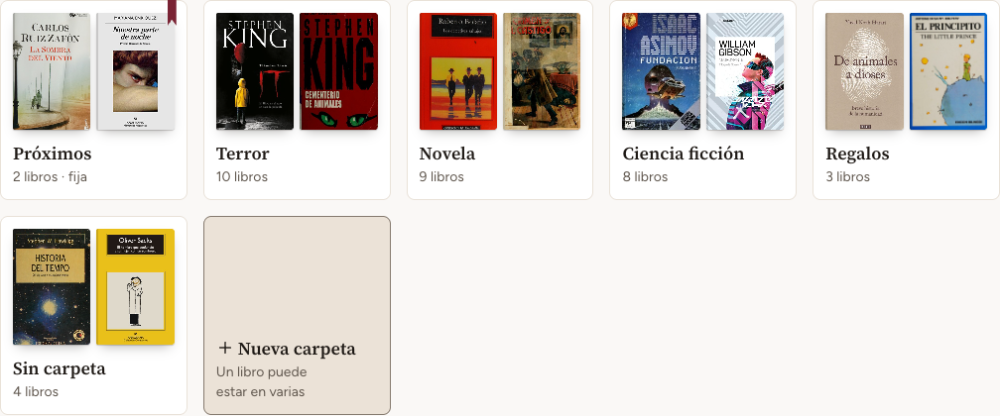
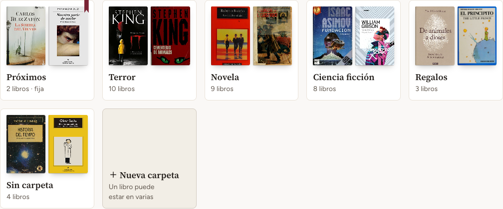
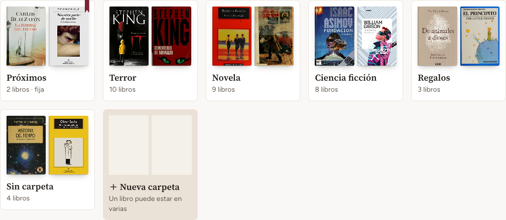
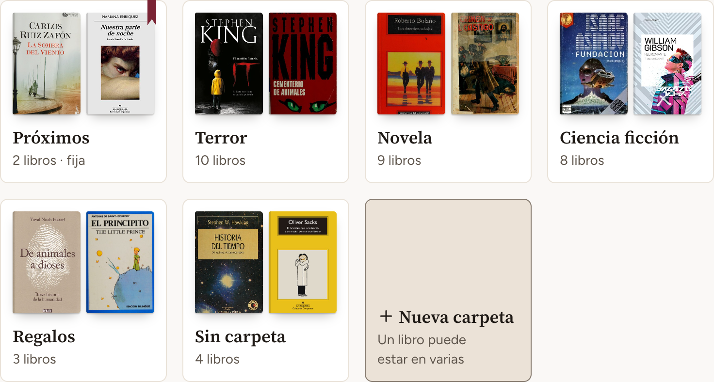
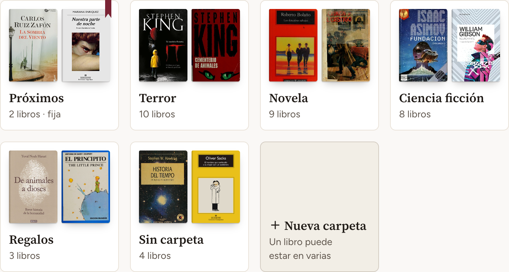
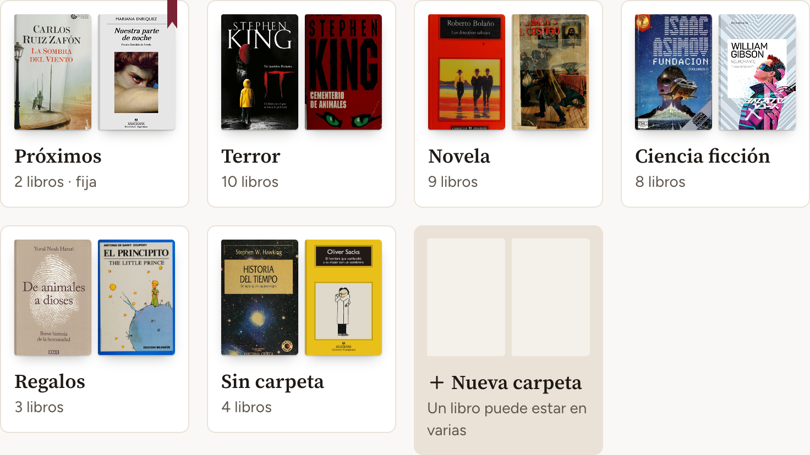

# Decisiones para el CP4

Notas para armar la página del checkpoint. Las capturas están al lado, en `capturas/`.

## Cuánto pesa "+ Nueva carpeta" en reposo

**Por qué surgió.** Crear una carpeta es la acción menos frecuente del tablero, y en tablet y computador la tarjeta pesa más que las carpetas. Su borde llega a 3,96:1 sobre el papel, contra 1,21:1 del de una carpeta. El modelo aprobado resuelve la misma tarjeta sin borde. El evaluador lo levantó en las dos rondas de Mis libros, como decisión y no como error.

**Por defecto:** la opción A, que es como está construida. El aspecto queda como está hasta que Matías elija.

| Opción                                                                       | Qué cambia                                                                                                                                         | Consecuencia                                                                                                                                                                                                   |
| ---------------------------------------------------------------------------- | -------------------------------------------------------------------------------------------------------------------------------------------------- | -------------------------------------------------------------------------------------------------------------------------------------------------------------------------------------------------------------- |
| **A. Bloque arena con borde** (la construida)                                | Nada                                                                                                                                               | Es la tarjeta más marcada del tablero y nunca pasa por carpeta. Atrae más que las carpetas, que son lo que la persona viene a ver                                                                              |
| **B. Tenue** (la que sugiere el evaluador)                                   | Desde tablet, fondo concha con borde de línea, que pasa a arena bajo el cursor. En celular sigue igual, porque ahí la tarjeta es más baja y no compite | Queda por debajo de las carpetas y se sigue leyendo: el texto secundario da 6,37:1. El borde es decorativo (1,21:1) y el fondo casi no se separa del papel (1,06:1), así que el más y el nombre la identifican |
| **C. Como el modelo:** arena sin borde, con dos huecos de portada más claros | Quita el borde y vuelve a poner los huecos                                                                                                         | Calza con la referencia aprobada. Los huecos también marcan una carpeta sin libros, así que se parece a una carpeta vacía de verdad, y `DESIGN.md` hoy los descarta por eso                                    |

**Cuánto cuesta cambiarla.** Poco en las dos: una línea de clases en la tarjeta y sus frases de `DESIGN.md`. La C suma los dos huecos y deja sin efecto la regla que los descarta.

### Capturas

Computador, 1280 px:

| A. Construida                                       | B. Tenue (simulada en el navegador)                  | C. Modelo aprobado                                    |
| --------------------------------------------------- | ---------------------------------------------------- | ----------------------------------------------------- |
|  |  |  |

Tablet, 768 px:

| A. Construida                                      | B. Tenue (simulada en el navegador)                 | C. Modelo aprobado                                   |
| -------------------------------------------------- | --------------------------------------------------- | ---------------------------------------------------- |
|  |  |  |
